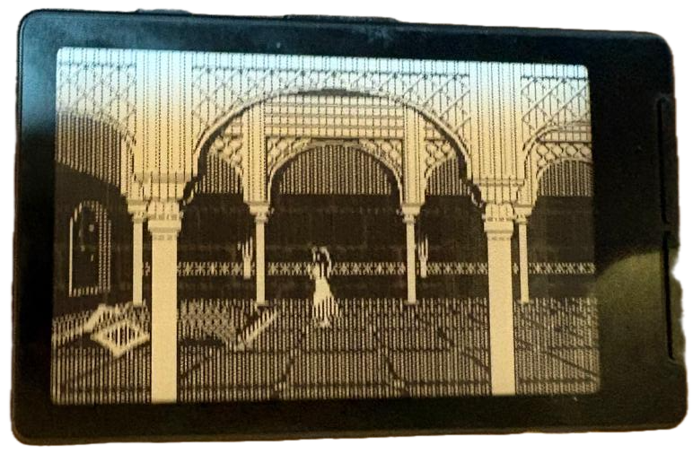

# Prince of Persia on the Xteink X4

Standalone firmware that runs Jordan Mechner's Apple II Prince of Persia on an
Xteink X4 e-reader (ESP32-C3, 800×480 e-ink). It plays the title sequence and
the attract-mode demo, stretched to the whole panel. No sound, and the
buttons do not play the game: after 30 s with no button pressed it shows the
title screen and sleeps; the power button wakes it and the demo starts over.
Control support to actually play the game is still to be added.

Inside is a small Apple IIe emulator in portable C (`core/`): a 6502, 128K of
banked memory, the soft switches the game uses, a stub ROM, and a disk trap
that serves blocks from an image built from the published source.

## Warning

This project uses a custom waveform LUT that drives the e-ink panel outside of
its normal operating parameters. It may cause permanent damage to your display.
Use at your own risk — I take no responsibility for any damage caused.

## Requirements

macOS with Docker, PlatformIO (`pio`), SDL2 (`brew install sdl2`), Python 3
and git.

## Quick start

    make game          # build the disk image from source (Docker)
    make test          # unit tests, boot smoke test, golden frames
    make run           # watch it in an SDL window

    make backup        # save the X4's flash first: this replaces its firmware
    make flash         # build and write the firmware (port=... if not found)
    make monitor       # serial log

`make help` lists every target.

## Options

| Option | Effect |
|---|---|
| `make flash fast=1` | Custom 4-frame waveform: ~6 pictures/s instead of ~2. **It drives the panel outside its rated parameters and may damage it permanently.** |
| `make flash halt=1` | Boots into the halt screen, to check error reporting. |
| `make flash sleep_usb=1` | Sleeps after 30 s even while USB is connected. By default it stays awake on USB so it can be flashed; asleep, it disappears from USB until the power button wakes it. |

Panel tuning (`ROTATE_180`, `INVERT_VIDEO`, `FULL_REFRESH_EVERY`, SPI clock)
lives in `firmware/src/config.h`.

## Restore the e-reader firmware

    make restore       # writes backup/x4-flash-backup.bin back

## Measured on the device

- Emulation speed, unpaced: 197% of real time; paced to real time while running
- Pictures per second in the demo level: ~5.7 with `fast=1`; ~1.8 without
  (measured before the picture was stretched to the full panel)
- Free heap while running: 103,516 bytes
- Full refresh every 150 pictures to clear ghosting

## Credits and legal

This is a fork of
[jmechner/Prince-of-Persia-Apple-II](https://github.com/jmechner/Prince-of-Persia-Apple-II)
ported to the Xteink X4. It is built for educational purposes only.

The fast waveform comes from
[xteink-bad-apple](https://github.com/CidVonHighwind/xteink-bad-apple)
(GPL-2.0). The CPU core is Mike Chambers' public-domain fake6502.

Jordan Mechner published the Apple II source for study and modification and
stated that this is not a grant of rights in Prince of Persia, which belongs
to Ubisoft. This repository contains no game code, game data or Apple ROM.
The game is built locally for personal use and is never committed.

## License

This project's original code is released under the [MIT License](LICENSE). The
custom 4-frame waveform data embedded in `firmware/src/display.cpp` comes from
xteink-bad-apple and remains under GPL-2.0.
